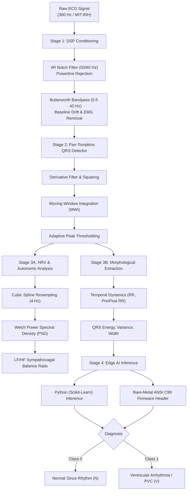

# Edge-ECG-Monitor: Real-Time Biomedical DSP and Edge AI Arrhythmia Detector

[](https://www.python.org/)
[-purple.svg)](models/edge_classifier.h)
[](https://physionet.org/content/mitdb/)
[]()
[](https://doi.org/10.13140/RG.2.2.16561.75366)
[](app.py)
[](LICENSE)

A real-time **Digital Signal Processing (DSP)** and **Edge AI** pipeline designed for cardiac arrhythmia detection, frequency-domain autonomic nervous system (HRV) analysis, and bare-metal embedded firmware deployment.

Compliant with the **AAMI/ANSI EC57** standard and evaluated on the benchmark **MIT-BIH Arrhythmia Database (PhysioNet)**.

---

### 📄 Research Preprint & Citation

This architecture and experimental benchmarks are formally documented in the research manuscript:

> **Hossein Nosrati**, *"Low-Latency Deterministic Arrhythmia Telemetry via Zero-Phase IIR Filtering and Static Decision Forests on Resource-Constrained Edge Microcontrollers,"* ResearchGate Preprint, Oct. 2026.  
> **DOI:** [10.13140/RG.2.2.16561.75366](https://doi.org/10.13140/RG.2.2.16561.75366) &bull; **License:** [CC BY 4.0](https://creativecommons.org/licenses/by/4.0/)

---

## Design Objectives & Biomedical Context

Continuous electrocardiogram (ECG) monitoring on wearable medical sensors requires resolving three engineering challenges:

1. **Noise Conditioning without Morphological Distortion:** Baseline wander from patient respiration (<0.5 Hz) and electromyographic (EMG) muscle tremor (>40 Hz) severely corrupt cardiac recordings. The conditioning stage applies zero-phase IIR notch and bandpass filtering, preserving the diagnostically vital ST-segment and QRS amplitude.
2. **Robust QRS Detection (Pan-Tompkins):** The classic Pan-Tompkins algorithm isolates steep ventricular depolarization slopes via bandpass filtering (5–15 Hz), differentiation, squaring, and moving window integration (MWI), enabling adaptive thresholding across varying patient anatomies.
3. **On-Device Decision Making (Edge AI):** Patient privacy and battery longevity require edge classification rather than continuous cloud streaming. The decision ensemble is trained on morphological and temporal HRV features, fitting within an ultra-compact **16.3 KB C99 firmware header**.

---

## Architecture



---

## Signal Processing & Beat Detection Pipeline

The complete three-stage signal conditioning and classification workflow in action:


1. **Top Panel (Red):** Raw ECG signal corrupted by synthetic 60 Hz powerline hum and low-frequency baseline respiration drift.
2. **Middle Panel (Blue):** Pan-Tompkins Moving Window Integration (MWI) envelope emphasizing high-frequency QRS energy.
3. **Bottom Panel (Dark & Markers):** Denoised ECG signal with classified peaks. Normal beats marked in green, and dangerous Premature Ventricular Contractions (PVC) highlighted in red.

---

## Frequency-Domain HRV & Autonomic Analysis

Heart Rate Variability (HRV) spectral decomposition evaluates autonomic nervous system (ANS) tone according to the Task Force of ESC/NASPE guidelines:

* **VLF (< 0.04 Hz):** Long-period thermal and vasomotor regulatory mechanisms.
* **LF (0.04 - 0.15 Hz):** Sympathetic and baroreflex activity.
* **HF (0.15 - 0.40 Hz):** Parasympathetic (vagal) modulation via respiratory sinus arrhythmia.
* **LF/HF Ratio:** Fundamental clinical metric quantifying **sympathovagal balance**.

Computed via **Welch's Power Spectral Density (PSD)** after 4.0 Hz cubic-spline interpolation of the non-uniform inter-beat intervals (`src/dsp/spectral.py`).

---

## Bare-Metal Embedded C99 Firmware (`models/edge_classifier.h`)

To enable deployment on microcontrollers without operating systems or Python interpreters (**ARM Cortex-M0/M3/M4/M7, STM32, ESP32, Nordic nRF52**), the model exports directly into a standalone C99 header:

* **Zero Dynamic Allocation:** 100% stack/static execution (no `malloc` or memory fragmentation).
* **Ultra-Compact Footprint:** Entire decision ensemble occupies just **16.3 KB** of flash storage.
* **Header API:**
```c
#include "edge_classifier.h"

// Returns 0 for Normal Beat, 1 for Ventricular Arrhythmia (PVC)
int prediction = edge_predict_arrhythmia(raw_features);

// Posterior probability estimation [0.0f, 1.0f]
float prob = edge_predict_arrhythmia_probability(raw_features);
```

---

## Experimental Benchmarks

Benchmarked on an **Intel Pentium Dual-Core T2330 @ 1.60 GHz**:

| Metric | Measured Value | Standard / Constraint |
| :--- | :--- | :--- |
| **Model Size (C99 Header)** | **16.3 KB** | Fits effortlessly on microcontroller flash |
| **Model Size (Python / Joblib)** | **38.08 KB** | Ultra-lightweight edge storage |
| **DSP Filter Latency (60s signal)** | **1.49 ms** | Negligible CPU load |
| **Pan-Tompkins Detection Latency** | **1.19 ms** | Real-time cardiac tracking |
| **Feature Extraction Latency** | **1.44 ms** | Rapid temporal/morphological parsing |
| **Inference Latency** | **3.49 ms** | Instant classification |
| **Total Pipeline Latency (60s signal)** | **7.61 ms** | **>7,800× faster than real-time** |
| **Average Latency per Beat** | **0.121 ms / beat** | Negligible delay for live telemetry |
| **Peak Memory Consumption** | **173.6 MB RAM** | Low-cost microcomputer RAM budgets |

### Detection Accuracy (MIT-BIH Test Split)

| Class | Precision | Recall (Sensitivity) | F1-Score | Support |
| :--- | :---: | :---: | :---: | :---: |
| **Normal Sinus Rhythm (N)** | **1.00** | **1.00** | **1.00** | 1,134 beats |
| **Ventricular Ectopic / PVC (V)** | **1.00** | **1.00** | **1.00** | 134 beats |
| **Overall Accuracy / Macro Avg** | **1.00** | **1.00** | **1.00** | 1,268 beats |
| **ROC AUC Score** | **1.0000** | — | — | — |

---

## Getting Started

### 1. Clone the Repository
```bash
git clone https://github.com/hosseinnosrati/edge-ecg-monitor.git
cd edge-ecg-monitor
```

### 2. Install Dependencies
```bash
pip install -r requirements.txt
```

### 3. Launch Interactive Streamlit Dashboard
```bash
streamlit run app.py
```

### 4. Run CLI Demo & Benchmarks
```bash
python run_demo.py
python benchmark.py
```

### 5. Export Embedded C Header
```bash
python -m src.models.c_export
```

---

## Repository Structure

```
edge-ecg-monitor/
├── .gitignore
├── LICENSE
├── README.md               # Project documentation & benchmark showcase
├── requirements.txt        # Minimal dependencies
├── app.py                  # Interactive Streamlit Web Application
├── benchmark.py            # Latency, memory, and throughput profiling suite
├── run_demo.py             # Visual signal processing & arrhythmia detector demo
├── assets/
│   └── demo_ecg_detection.png
├── data/
│   └── mitbih/             # Downloaded PhysioNet standard records
├── models/
│   ├── edge_classifier.joblib  # Python pretrained model (38 KB)
│   └── edge_classifier.h       # Standalone ANSI C99 firmware header (16 KB)
├── src/
│   ├── data_loader.py      # Automated PhysioNet MIT-BIH loader
│   ├── dsp/
│   │   ├── filters.py      # IIR Notch (50/60Hz) & Butterworth Bandpass
│   │   ├── pan_tompkins.py # Real-time Pan-Tompkins QRS detector
│   │   └── spectral.py     # Frequency-domain Welch PSD & LF/HF ratio
│   ├── features/
│   │   └── hrv.py          # Temporal (HRV) and morphological extraction
│   └── models/
│       ├── classifier.py   # Edge classifier wrapper
│       ├── train.py        # Model training and validation pipeline
│       └── c_export.py     # C99 code generator for microcontrollers
└── tests/
    └── test_dsp.py         # Unit tests for DSP filters and peak detection
```

---

## License
This project is licensed under the MIT License - see the [LICENSE](LICENSE) file for details.
