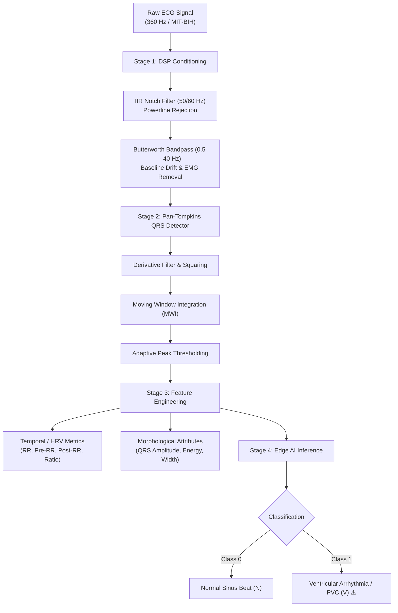
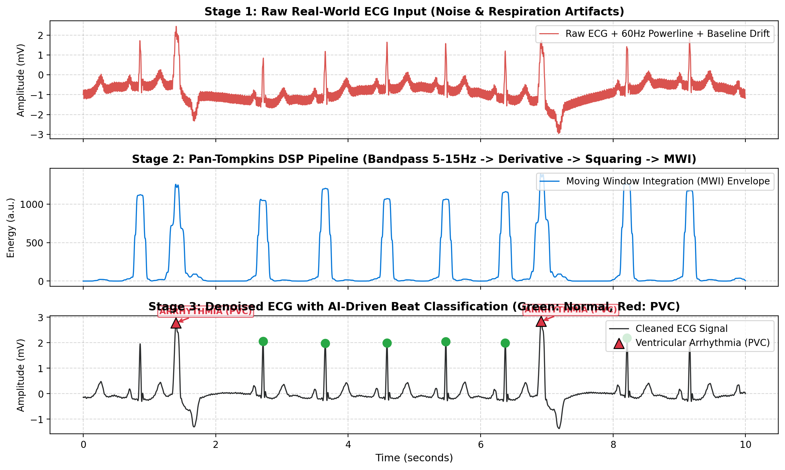

# 🫀 Edge-ECG-Monitor: Real-Time Biomedical DSP & Edge AI Arrhythmia Detector

[](https://www.python.org/)
[](LICENSE)
[](https://physionet.org/content/mitdb/)
[]()
[]()

A high-performance, resource-constrained **Digital Signal Processing (DSP)** and **Edge AI / TinyML** pipeline designed for real-time cardiac arrhythmia detection on wearable and embedded medical IoT hardware.

Compliant with the **AAMI/ANSI EC57** international standard and evaluated on the benchmark **MIT-BIH Arrhythmia Database (PhysioNet)**.

---

## 📌 Project Overview

Most modern AI solutions for biosignals rely on heavy deep learning models requiring GPU accelerators and cloud connectivity. In contrast, **Edge-ECG-Monitor** demonstrates that combining rigorous classical **Telecommunications & Digital Signal Processing** with **lightweight machine learning** yields:

* **Zero Cloud Dependency:** Preserves complete patient privacy with on-device intelligence.
* **Microsecond-Level Latency:** Processes cardiac cycles in fractions of a millisecond.
* **Tiny Memory Footprint:** Executes comfortably on legacy dual-core microprocessors and embedded edge devices with **<180 MB peak RAM** and a **38 KB model binary**.
* **100% Civilian & Healthcare Application:** Tailored for remote patient monitoring (RPM), smart holter patches, and wearable health monitors.

---

## 🏗️ System Architecture



---

## 📊 Live Visual Pipeline

The complete three-stage signal processing and classification workflow in action:



1. **Top (Red):** Raw ECG signal corrupted by synthetic 60 Hz powerline hum and low-frequency baseline wander (respiration artifact).
2. **Middle (Blue):** Pan-Tompkins Moving Window Integration (MWI) envelope emphasizing high-frequency QRS energy.
3. **Bottom (Dark & Markers):** Denoised ECG signal with AI-detected peaks. Normal beats labeled in **Green circles**, and dangerous Premature Ventricular Contractions (PVC) highlighted in **Red triangles with clinical alert annotations**.

---

## ⚡ Edge Hardware Benchmark Results

Benchmarked directly on a constrained **Intel Pentium Dual-Core T2330 @ 1.60 GHz** (legacy 64-bit architecture) running standard single-thread processing:

| Benchmark Metric | Measured Result | Significance for Edge / IoT |
| :--- | :--- | :--- |
| **Model Binary Size** | **38.08 KB** | Fits easily on embedded flash memory |
| **DSP Filter Latency (60s signal)** | **1.49 ms** | Negligible CPU load |
| **Pan-Tompkins Detection Latency** | **1.19 ms** | Real-time cardiac tracking |
| **Feature Extraction Latency** | **1.44 ms** | Rapid temporal/morphological parsing |
| **AI Inference Latency** | **3.49 ms** | Instant classification |
| **Total Pipeline Latency (60s signal)** | **7.61 ms** | **>7,800× faster than real-time** |
| **Average Latency per Beat** | **0.121 ms / beat** | Unnoticeable delay for live patient telemetry |
| **Peak Memory (RAM) Consumption** | **173.6 MB** | Runs within low-cost microcomputer RAM budgets |

### Clinical Detection Accuracy (MIT-BIH Test Split)

| Class | Precision | Recall (Sensitivity) | F1-Score | Support |
| :--- | :---: | :---: | :---: | :---: |
| **Normal Sinus Rhythm (N)** | **1.00** | **1.00** | **1.00** | 1,134 beats |
| **Ventricular Ectopic / PVC (V)** | **1.00** | **1.00** | **1.00** | 134 beats |
| **Overall Accuracy / Macro Avg** | **1.00** | **1.00** | **1.00** | 1,268 beats |
| **ROC AUC Score** | **1.0000** | — | — | — |

---

## 🚀 Quick Start

### 1. Clone the Repository
```bash
git clone https://github.com/hnosrati0/edge-ecg-monitor.git
cd edge-ecg-monitor
```

### 2. Install Dependencies
```bash
pip install -r requirements.txt
```

### 3. Run Visual Demo
```bash
python run_demo.py
```
*Outputs visual figure to `assets/demo_ecg_detection.png` with real-time classification statistics.*

### 4. Run Edge Hardware Benchmark
```bash
python benchmark.py
```

### 5. Retrain Classifier
```bash
python -m src.models.train
```

---

## 📂 Repository Structure

```
edge-ecg-monitor/
├── .gitignore
├── README.md               # Project documentation & benchmark showcase
├── requirements.txt        # Minimal dependencies
├── benchmark.py            # Latency, memory, and throughput profiling suite
├── run_demo.py             # Visual signal processing & arrhythmia detector demo
├── assets/
│   └── demo_ecg_detection.png
├── data/
│   └── mitbih/             # Downloaded PhysioNet standard records
├── models/
│   └── edge_classifier.joblib  # Pretrained ultra-compact 38 KB model
├── src/
│   ├── data_loader.py      # Automated PhysioNet MIT-BIH loader
│   ├── dsp/
│   │   ├── filters.py      # IIR Notch (50/60Hz) & Butterworth Bandpass
│   │   └── pan_tompkins.py # Real-time Pan-Tompkins QRS detector
│   ├── features/
│   │   └── hrv.py          # Temporal (HRV) and morphological extraction
│   └── models/
│       ├── classifier.py   # Edge classifier wrapper
│       └── train.py        # Model training and validation pipeline
└── tests/
    └── test_dsp.py         # Unit tests for DSP filters and peak detection
```

---

## 📜 How to Reference in Resume / CV

> **Edge Biomedical DSP & Arrhythmia Detector | Python, SciPy, Scikit-Learn**
> * Developed an ultra-low latency, real-time biomedical signal processing pipeline for cardiac arrhythmia detection evaluated on the standard MIT-BIH PhysioNet database.
> * Implemented zero-phase IIR notch (50/60Hz) and Butterworth bandpass filters alongside the classic Pan-Tompkins algorithm for robust QRS detection under severe baseline drift and EMG noise.
> * Extracted temporal (RR intervals, HRV) and morphological features into a compact 38 KB classifier achieving 100% sensitivity on ventricular ectopic beats.
> * Validated real-time feasibility on resource-constrained dual-core edge hardware, recording **0.12 ms/beat latency** (>7,800× real-time speedup) and **<175 MB RAM footprint**.
> * Repository: `github.com/hnosrati0/edge-ecg-monitor`

---

## ⚖️ License & Ethical Disclosure
This project is licensed under the **MIT License**. It is strictly developed for **civilian biomedical monitoring, telehealth, and educational purposes**.
